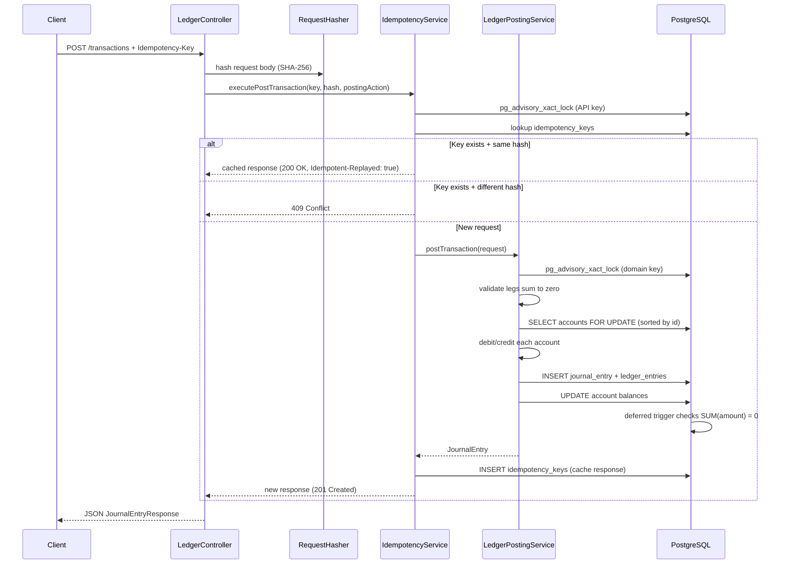
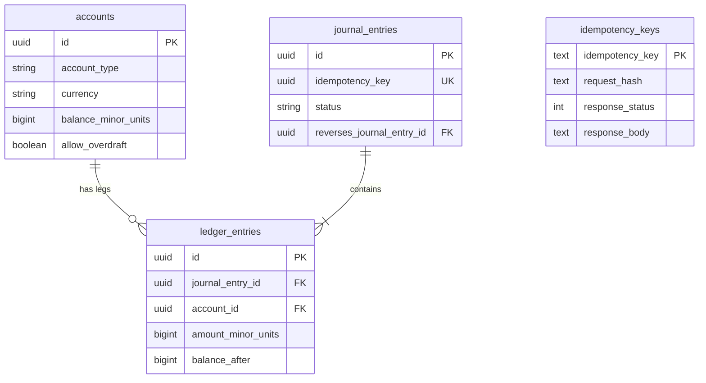

[](https://github.com/Ayshasharaf/double-entry-ledger/actions/workflows/ci.yml)

# DoubleLedger — ledger-core

A **double-entry financial ledger** built with **Java 21**, **Spring Boot 4**, and **PostgreSQL**.

Money never appears or disappears — it only moves. Every transaction is recorded as balanced legs (debits = credits), stored atomically, and protected against duplicate requests and concurrent race conditions.

This repository is a **complete, self-contained ledger service** for learning and demos: posting, reversals, idempotency, and concurrency control. It is intentionally **not** a full production platform (see [Limitations](#limitations)).

---

## What this project is

**DoubleLedger** is a **ledger API**: create accounts, post **balanced multi-leg journal entries**, read balances and history, and **reverse** mistakes — over HTTP with PostgreSQL as the source of truth.

It is **not** a payment processor (Stripe) or a full bank core. It sits in the same category as the **ledger layer** in products like **[Modern Treasury](https://www.moderntreasury.com/)** and **[Formance Ledger](https://docs.formance.com/modules/ledger)** — the service that owns **double-entry books** while payments, login, and cards live elsewhere.

```
Your app / payment service          ← optional, not in this repo
        │  POST /api/v1/transactions + Idempotency-Key
        ▼
DoubleLedger (this repo)            ← accounts, postings, reversals, idempotency
        ▼
PostgreSQL                          ← triggers, locks, ACID
```

**Who uses it:** backend developers calling the REST API locally or via Docker. The API is **open** (no auth) — fine for learning; do not expose it on the public internet as-is.

**Related docs in this repo:** [UNDERSTANDING.md](./UNDERSTANDING.md) (accounting intuition), [CODEBASE_LEARNING.md](./CODEBASE_LEARNING.md) (guided study), [ARCHITECTURE_TEACHING_GUIDE.md](./ARCHITECTURE_TEACHING_GUIDE.md) (layer-by-layer tour).

---

## Table of contents

1. [What this project is](#what-this-project-is)
2. [Quick start](#quick-start)
3. [Walkthrough — first transfer end-to-end](#walkthrough--first-transfer-end-to-end)
4. [API reference](#api-reference)
5. [Is the app "complete"?](#is-the-app-complete)
6. [Architecture overview](#architecture-overview)
7. [Code map](#code-map)
8. [Data flow — start to finish](#data-flow--start-to-finish)
9. [Database design](#database-design)
10. [Rules & principles](#rules--principles)
11. [Testing](#testing)
12. [Docker — what it does here](#docker--what-it-does-here)
13. [CI](#ci)
14. [API examples](#api-examples)
15. [What I learned](#what-i-learned)
16. [Limitations](#limitations)
17. [Tech stack](#tech-stack)
18. [Further reading](#further-reading)

---

## Quick start

### Prerequisites


| Requirement    | Why                                                                            |
| -------------- | ------------------------------------------------------------------------------ |
| **Java 21+**   | Project target (`pom.xml`). Java 26 works too.                                 |
| **Maven**      | Included via `./mvnw` wrapper — no separate install needed.                    |
| **PostgreSQL** | Required to run the app locally.                                               |
| **Docker**     | Required for integration tests (Testcontainers). Optional for running the app. |


**Java version:** the project targets **Java 21** (`pom.xml`). If `./mvnw` fails with a Java version error, point `JAVA_HOME` at JDK 21+ (e.g. `brew install openjdk@21` on macOS).

### Run the app

1. Start PostgreSQL with a database matching `application.properties`:
  ```
   Host:     localhost:5433
   Database: ledger_db
   User:     ledger_admin
   Password: ledger1234
  ```
2. Start Spring Boot (pick one):
  **Option A — Docker Compose (recommended):**
   **Option B — local Postgres + Maven:**
   Flyway runs migrations automatically on startup. The app listens on **port 8080** by default.

### Run tests

```bash
# All tests
./mvnw clean test

# Unit tests only (no Docker required)
./mvnw test -Dtest="AccountTest,RequestHasherTest,LedgerPostingServiceValidationTest,AccountBalanceServiceTest"

# Integration tests only (requires Docker)
./mvnw clean test -Dtest="*IntegrationTest*,LedgerApplicationTests"

# One test class
./mvnw test -Dtest=IdempotencyIntegrationTest

# One test method
./mvnw test -Dtest=IdempotencyIntegrationTest#sequentialReplay_returns200WithReplayHeader
```

**Expected result when healthy:**

```
Tests run: 37, Failures: 0, Errors: 0, Skipped: 0
BUILD SUCCESS
```

- **Unit tests** (19 tests) run without Docker.
- **Integration tests** (18 tests) need **Docker Desktop running** (Testcontainers), or local Postgres on `localhost:5433` with `-Dtest.useLocalPostgres=true`.

---

## Walkthrough — first transfer end-to-end

With the app running (`docker compose up --build` or `./mvnw spring-boot:run` + Postgres on port **5433**), run these steps. Amounts are **minor units** (500 = $5.00 USD).

**1. Create a wallet (asset account)**

```bash
WALLET=$(curl -s -X POST http://localhost:8080/api/v1/accounts \
  -H "Content-Type: application/json" \
  -d '{
    "name": "wallet",
    "accountType": "asset",
    "normalBalance": "D",
    "currency": "USD",
    "allowOverdraft": false,
    "overdraftLimitMinorUnits": 0
  }' | jq -r '.id')
echo "wallet=$WALLET"
```

**2. Create an equity account (for opening balance — same pattern tests use internally)**

```bash
EQUITY=$(curl -s -X POST http://localhost:8080/api/v1/accounts \
  -H "Content-Type: application/json" \
  -d '{
    "name": "opening-equity",
    "accountType": "equity",
    "normalBalance": "C",
    "currency": "USD",
    "allowOverdraft": false,
    "overdraftLimitMinorUnits": 0
  }' | jq -r '.id')
echo "equity=$EQUITY"
```

**3. Fund the wallet ($100.00)** — balanced entry: debit wallet, credit equity

```bash
curl -s -X POST http://localhost:8080/api/v1/transactions \
  -H "Content-Type: application/json" \
  -H "Idempotency-Key: $(uuidgen | tr '[:upper:]' '[:lower:]')" \
  -d "{
    \"description\": \"opening balance\",
    \"legs\": [
      { \"accountId\": \"$WALLET\", \"amountMinorUnits\": 10000, \"direction\": \"DEBIT\" },
      { \"accountId\": \"$EQUITY\", \"amountMinorUnits\": 10000, \"direction\": \"CREDIT\" }
    ]
  }" | jq
```

**4. Create a pool account and transfer $5.00 wallet → pool**

```bash
POOL=$(curl -s -X POST http://localhost:8080/api/v1/accounts \
  -H "Content-Type: application/json" \
  -d '{
    "name": "cash-pool",
    "accountType": "asset",
    "normalBalance": "D",
    "currency": "USD",
    "allowOverdraft": false,
    "overdraftLimitMinorUnits": 0
  }' | jq -r '.id')

IDEM=$(uuidgen | tr '[:upper:]' '[:lower:]')
curl -s -X POST http://localhost:8080/api/v1/transactions \
  -H "Content-Type: application/json" \
  -H "Idempotency-Key: $IDEM" \
  -d "{
    \"description\": \"transfer to pool\",
    \"legs\": [
      { \"accountId\": \"$WALLET\", \"amountMinorUnits\": 500, \"direction\": \"CREDIT\" },
      { \"accountId\": \"$POOL\",   \"amountMinorUnits\": 500, \"direction\": \"DEBIT\"  }
    ]
  }" | jq
```

**5. Check balances**

```bash
curl -s "http://localhost:8080/api/v1/accounts/$WALLET" | jq '.balanceMinorUnits'
curl -s "http://localhost:8080/api/v1/accounts/$POOL" | jq '.balanceMinorUnits'
```

**6. Retry the same transfer** (same `Idempotency-Key`) — expect `200 OK` and header `Idempotent-Replayed: true`

```bash
curl -s -D - -X POST http://localhost:8080/api/v1/transactions \
  -H "Content-Type: application/json" \
  -H "Idempotency-Key: $IDEM" \
  -d "{
    \"description\": \"transfer to pool\",
    \"legs\": [
      { \"accountId\": \"$WALLET\", \"amountMinorUnits\": 500, \"direction\": \"CREDIT\" },
      { \"accountId\": \"$POOL\",   \"amountMinorUnits\": 500, \"direction\": \"DEBIT\"  }
    ]
  }" -o /dev/null
```

On macOS, `uuidgen` produces UUIDs suitable for `Idempotency-Key`. On Linux, use `uuidgen` or any fresh UUID v4 string.

---

## API reference

Base URL: `http://localhost:8080/api/v1`


| Method | Path                                       | Idempotency-Key     | Description                        |
| ------ | ------------------------------------------ | ------------------- | ---------------------------------- |
| `POST` | `/accounts`                                | No                  | Create account                     |
| `GET`  | `/accounts`                                | No                  | List all accounts                  |
| `GET`  | `/accounts/{id}`                           | No                  | Get one account (includes balance) |
| `POST` | `/transactions`                            | **Required** (UUID) | Post balanced journal entry        |
| `GET`  | `/transactions/{journalEntryId}`           | No                  | Read entry, legs, metadata         |
| `POST` | `/transactions/{journalEntryId}/reversals` | **Required** (UUID) | Reverse a posted entry             |


**Account types:** `asset`, `liability`, `equity`, `revenue`, `expense`. **Normal balance:** `D` or `C`. **Leg direction:** `DEBIT` or `CREDIT`. All legs in one transaction must share one **currency** and sum to zero.

---

## Is the app "complete"?

The **core ledger** is working when all of these are true:


| Check                    | How to verify                                                      |
| ------------------------ | ------------------------------------------------------------------ |
| Spring context starts    | `LedgerApplicationTests.contextLoads` passes                       |
| Database schema is valid | Flyway migrations `V1` + `V2` run without error                    |
| Posting works            | Integration tests pass (balance updates, zero-sum enforced)        |
| Reversals work           | `ReversalIntegrationTest` passes                                   |
| Idempotency works        | 50 concurrent retries → 1 create + 49 replays                      |
| Concurrency is safe      | 10 parallel withdrawals → exactly 1 rejection, no deadlock         |
| Unit tests pass          | `AccountTest`, `RequestHasherTest`, validation tests (no Docker)   |
| API is reachable         | `POST /api/v1/accounts` and `POST /api/v1/transactions` return 201 |


Features **outside this project’s scope** (auth, outbox, idempotency TTL, etc.) are listed under [Limitations](#limitations) — not planned in this repo for now.

---

## Architecture overview

```
┌─────────────────────────────────────────────────────────────────┐
│                         HTTP Client                              │
└────────────────────────────┬────────────────────────────────────┘
                             │  POST /api/v1/transactions
                             │  Header: Idempotency-Key
                             ▼
┌─────────────────────────────────────────────────────────────────┐
│  controller/                                                     │
│  LedgerController          GlobalExceptionHandler                │
└────────────────────────────┬────────────────────────────────────┘
                             │
              ┌──────────────┼──────────────┐
              ▼              ▼              ▼
┌──────────────────┐ ┌─────────────┐ ┌──────────────────┐
│ IdempotencyService│ │RequestHasher│ │LedgerPostingService│
│ (API-layer cache) │ │ (SHA-256)   │ │ (core engine)     │
└────────┬─────────┘ └─────────────┘ └────────┬─────────┘
         │                                     │
         └──────────────┬──────────────────────┘
                        ▼
┌─────────────────────────────────────────────────────────────────┐
│  repository/          JPA + Hibernate                            │
│  AccountRepository · JournalEntryRepository · LedgerEntryRepository│
│  IdempotencyKeyRepository                                         │
└────────────────────────────┬────────────────────────────────────┘
                             │  SELECT ... FOR UPDATE (row locks)
                             │  pg_advisory_xact_lock (idempotency)
                             ▼
┌─────────────────────────────────────────────────────────────────┐
│  PostgreSQL                                                      │
│  Flyway migrations · constraint triggers · ACID transactions     │
└─────────────────────────────────────────────────────────────────┘
```

### Layer responsibilities


| Layer                    | Responsibility                                              |
| ------------------------ | ----------------------------------------------------------- |
| **Controller**           | HTTP in/out, validation, idempotency header parsing         |
| **IdempotencyService**   | API-layer dedup — replay cached HTTP responses on retry     |
| **LedgerPostingService** | Domain logic — lock accounts, apply legs, update balances   |
| **Account (entity)**     | Debit/credit rules per account type, overdraft checks       |
| **Repository**           | Database access with pessimistic write locks                |
| **PostgreSQL**           | Final backstop — zero-sum trigger, unique constraints, ACID |


---

## Code map

```
ledger/
├── src/main/java/com/doubleledger/ledger/
│   ├── LedgerApplication.java          ← Spring Boot entry point
│   │
│   ├── controller/
│   │   ├── LedgerController.java       ← REST API (/accounts, /transactions)
│   │   └── GlobalExceptionHandler.java ← 400 / 409 / 500 error responses
│   │
│   ├── dto/                            ← Request/response shapes (no business logic)
│   │   ├── CreateAccountRequest.java
│   │   ├── PostTransactionRequest.java
│   │   ├── TransactionLegDto.java
│   │   └── *Response.java
│   │
│   ├── service/
│   │   ├── LedgerPostingService.java   ← Core posting engine + reversals
│   │   ├── IdempotencyService.java     ← API idempotency cache
│   │   ├── AccountService.java         ← Account CRUD
│   │   ├── AccountBalanceService.java  ← Derived balance math
│   │   └── JournalEntryResponseService.java
│   │
│   ├── util/
│   │   └── RequestHasher.java          ← SHA-256 fingerprint of request body
│   │
│   ├── audit/
│   │   └── ForensicAuditService.java   ← Structured error logging
│   │
│   ├── persistence/
│   │   └── PostgresAdvisoryLockService.java
│   │
│   ├── repository/                     ← Spring Data JPA interfaces
│   │   ├── AccountRepository.java      ← includes findAllByIdsForUpdate()
│   │   ├── JournalEntryRepository.java
│   │   ├── LedgerEntryRepository.java
│   │   └── IdempotencyKeyRepository.java
│   │
│   ├── model/                          ← JPA entities ↔ database tables
│   │   ├── Account.java                ← validateBalance(), overdraft rules
│   │   ├── JournalEntry.java           ← transaction header
│   │   ├── LedgerEntry.java            ← one leg (signed amount)
│   │   └── IdempotencyKey.java         ← cached API response
│   │
│   └── config/
│       └── AsyncConfig.java
│
├── src/main/resources/
│   ├── application.properties          ← DB connection, Flyway, logging
│   └── db/migration/
│       ├── V1__initial_ledger_schema.sql
│       └── V2__derived_balances_and_immutable_postings.sql
│
├── docker-compose.yml                  ← app + Postgres, one command
├── Dockerfile
│
└── src/test/java/com/doubleledger/ledger/
    ├── support/
    │   └── PostgresIntegrationTestSupport.java  ← Testcontainers + helpers
    ├── AccountTest.java                         ← unit: overdraft / frozen
    ├── util/RequestHasherTest.java              ← unit: hash stability
    ├── service/
    │   ├── LedgerPostingServiceValidationTest.java ← unit: zero-sum
    │   └── AccountBalanceServiceTest.java       ← unit: balance math
    ├── LedgerApplicationTests.java              ← smoke test
    ├── IdempotencyIntegrationTest.java          ← HTTP idempotency (3 tests)
    ├── LedgerPostingConcurrencyIntegrationTest.java ← locking (2 tests)
    ├── ReversalIntegrationTest.java             ← reversals (6 tests)
    └── TransactionReadIntegrationTest.java      ← GET + metadata (3 tests)
```

---

## Data flow — start to finish

### Example: transfer $5.00 from Wallet → Pool

**Request:**

```http
POST /api/v1/transactions
Idempotency-Key: 550e8400-e29b-41d4-a716-446655440000

{
  "description": "transfer to pool",
  "legs": [
    { "accountId": "<wallet-uuid>", "amountMinorUnits": 500, "direction": "CREDIT" },
    { "accountId": "<pool-uuid>",   "amountMinorUnits": 500, "direction": "DEBIT"  }
  ]
}
```

> Amounts are in **minor units** (cents). 500 = $5.00. No floats anywhere.

### Step-by-step flow




### What gets written to the database

For one $5.00 transfer, three rows change:

```
journal_entries          ledger_entries                    accounts
─────────────────        ─────────────────────────────     ────────────────
id: je-001               leg 1: wallet  amount = +500      wallet: 9500 → 9000
idempotency_key: ...     leg 2: pool    amount = -500      pool:   0    → 500
description: "transfer"  balance_after on each leg
status: posted
```

Signed amounts: **negative = debit**, **positive = credit**. They must sum to **zero** per journal entry (enforced by a deferred DB trigger at commit time).

---

## Database design




### Two idempotency layers (not redundant)


| Layer      | Table                             | Purpose                                                                  |
| ---------- | --------------------------------- | ------------------------------------------------------------------------ |
| **API**    | `idempotency_keys`                | Client retried HTTP call → replay exact same JSON response               |
| **Domain** | `journal_entries.idempotency_key` | Same business event can't be posted twice, even via different code paths |


Both use **Postgres advisory locks** (`pg_advisory_xact_lock`) to serialize concurrent requests with the same key.

---

## Rules & principles

### Accounting rules

1. **Double-entry invariant** — every journal entry's legs sum to zero (debits = credits).
2. **No floats** — all money stored as `BIGINT` minor units (cents).
3. **Single currency per transaction** — multi-currency requires explicit FX/clearing accounts (v2).
4. **Immutability** — entries are never edited or deleted; corrections use reversals (`POST /transactions/{id}/reversals`).

### Concurrency rules

1. **Pessimistic locking** — accounts are locked with `SELECT ... FOR UPDATE` before balance changes.
2. **Sorted lock order** — account IDs are locked in sorted order to prevent deadlocks.
3. **Advisory locks** — idempotency keys are serialized at both API and domain layers.

### Defense in depth


| Check                     | Where                                | What happens on failure                |
| ------------------------- | ------------------------------------ | -------------------------------------- |
| Legs balance to zero      | Java (`LedgerPostingService`)        | `400 Bad Request` before DB write      |
| Legs balance to zero      | PostgreSQL trigger                   | Transaction rolled back — can't commit |
| Overdraft                 | Java (`Account.validateOverdraft()`) | `400 Bad Request`                      |
| Duplicate idempotency key | Java + DB unique constraint          | Replay or `409 Conflict`               |
| Same key, different body  | Java (`IdempotencyService`)          | `409 Conflict`                         |


### API rules

- Every `POST /transactions` requires an `Idempotency-Key` header (UUID).
- Request body `idempotencyKey` must match the header if present.
- First successful post → `201 Created`. Exact retry → `200 OK` + `Idempotent-Replayed: true`.

---

## Testing

### Philosophy

Integration tests boot the **real Spring application** against a **real PostgreSQL** database. Unit tests cover pure validation logic without Spring or Docker.

### Unit tests (no Docker)


| Test class                           | What it proves                                  |
| ------------------------------------ | ----------------------------------------------- |
| `AccountTest`                        | Overdraft limits, frozen account rejection      |
| `RequestHasherTest`                  | Same body → same hash; key order independence   |
| `LedgerPostingServiceValidationTest` | Unbalanced legs, invalid direction, missing key |
| `AccountBalanceServiceTest`          | Signed-leg balance math per account type        |


```bash
./mvnw test -Dtest="AccountTest,RequestHasherTest,LedgerPostingServiceValidationTest,AccountBalanceServiceTest"
```

### Integration tests (Docker required)

### Tools


| Tool                 | Role                                                 |
| -------------------- | ---------------------------------------------------- |
| **JUnit 5**          | Test framework (`@Test`, `@BeforeEach`)              |
| **Spring Boot Test** | `@SpringBootTest` — loads full application context   |
| **Testcontainers**   | Spins up `postgres:16-alpine` in Docker during tests |
| **AssertJ**          | Readable assertions (`assertThat(x).isEqualTo(y)`)   |
| **RestTestClient**   | HTTP tests without manually starting a server        |
| **Flyway**           | Same migrations run in tests as in production        |
| **Maven Surefire**   | Runs tests via `./mvnw test`                         |


### Test suite (37 tests)


| Test                                                          | Layer   | What it proves                                       |
| ------------------------------------------------------------- | ------- | ---------------------------------------------------- |
| `AccountTest` (6)                                             | Unit    | Overdraft / frozen / closed validation               |
| `RequestHasherTest` (5)                                       | Unit    | Deterministic request fingerprints                   |
| `LedgerPostingServiceValidationTest` (4)                      | Unit    | Zero-sum and leg validation                          |
| `AccountBalanceServiceTest` (4)                               | Unit    | Balance math per account type                        |
| `contextLoads`                                                | Smoke   | Spring Boot + Postgres + Flyway all wire up          |
| `sameIdempotencyKey_concurrentPosts_createSingleJournalEntry` | HTTP    | 50 threads, 1 create + 49 replays                    |
| `sameIdempotencyKey_differentPayload_returns409`              | HTTP    | Same key + different amount → conflict               |
| `sequentialReplay_returns200WithReplayHeader`                 | HTTP    | Retry returns cached response                        |
| `concurrentWithdrawals_exhaustBalanceExactlyOneFails`         | Service | 10 threads, balance for 9 → 1 rejection, balance = 0 |
| `crossAccountTransfers_doNotDeadlock`                         | Service | 40 bidirectional A↔B transfers, no deadlock          |
| `ReversalIntegrationTest` (8)                                 | HTTP    | Reversal restores balances, idempotency, 409/404     |
| `TransactionReadIntegrationTest` (3)                          | HTTP    | GET transaction returns legs + metadata              |


### How tests get a database

```
PostgresIntegrationTestSupport (base class for all integration tests)
        │
        ├── Docker available?
        │     YES → Testcontainers starts postgres:16-alpine
        │           @DynamicPropertySource wires JDBC URL/username/password
        │
        └── NO  → Falls back to localhost:5433
                  (or force with -Dtest.useLocalPostgres=true)
```

Every test class extends `PostgresIntegrationTestSupport`, which provides:

- Automatic Postgres setup
- `createAssetAccount(name)` helper
- `buildTransfer(from, to, amount, idempotencyKey)` helper

---

## Docker

### Docker Compose — run app + Postgres

```bash
cd ledger
docker compose up --build
```

App: `http://localhost:8080` · Postgres: `localhost:5433`

### Docker for integration tests

```
┌──────────────────────────────────────────────────────────┐
│  ./mvnw test                                              │
│       │                                                   │
│       ▼                                                   │
│  Testcontainers ──► Docker ──► postgres:16-alpine         │
│       │                      (ephemeral, destroyed after) │
│       ▼                                                   │
│  Spring Boot test context connects to that Postgres       │
│  Flyway runs V1 + V2 migrations                           │
│  Tests run against real schema + real locks + real triggers│
└──────────────────────────────────────────────────────────┘
```


| Scenario                                | Docker needed?                                                   |
| --------------------------------------- | ---------------------------------------------------------------- |
| Run unit tests                          | **No**                                                           |
| Run integration tests                   | **Yes** — Testcontainers requires Docker running                 |
| Run the app locally (`spring-boot:run`) | **No** — uses Postgres at `localhost:5433`                       |
| Run app via Docker Compose              | **Yes** — `docker compose up --build`                            |
| Run tests without Docker                | Use `-Dtest.useLocalPostgres=true` + local Postgres on port 5433 |


**Make sure Docker Desktop is running before integration tests or `./mvnw test`.**

---

## CI

GitHub Actions runs `./mvnw clean test` on every push/PR to `main`:

```
.github/workflows/ci.yml
```

Requires Docker on the runner (provided by `ubuntu-latest`) for Testcontainers.

---

## API examples

### Create an account

```bash
curl -s -X POST http://localhost:8080/api/v1/accounts \
  -H "Content-Type: application/json" \
  -d '{
    "name": "wallet",
    "accountType": "asset",
    "normalBalance": "D",
    "currency": "USD",
    "allowOverdraft": false,
    "overdraftLimitMinorUnits": 0
  }' | jq
```

### Post a transaction

```bash
curl -s -X POST http://localhost:8080/api/v1/transactions \
  -H "Content-Type: application/json" \
  -H "Idempotency-Key: 550e8400-e29b-41d4-a716-446655440000" \
  -d '{
    "description": "transfer to pool",
    "legs": [
      { "accountId": "<wallet-uuid>", "amountMinorUnits": 500, "direction": "CREDIT" },
      { "accountId": "<pool-uuid>",   "amountMinorUnits": 500, "direction": "DEBIT"  }
    ]
  }' | jq
```

### Get account balance

```bash
curl -s http://localhost:8080/api/v1/accounts/<account-uuid> | jq
```

### Reverse a transaction

```bash
curl -s -X POST "http://localhost:8080/api/v1/transactions/<journal-entry-uuid>/reversals" \
  -H "Content-Type: application/json" \
  -H "Idempotency-Key: 660e8400-e29b-41d4-a716-446655440001" \
  -d '{ "description": "undo transfer" }' | jq
```

### Get a transaction

```bash
curl -s http://localhost:8080/api/v1/transactions/<journal-entry-uuid> | jq
```

### Retry (idempotent replay)

Send the exact same request again with the same `Idempotency-Key`:

```
HTTP/1.1 200 OK
Idempotent-Replayed: true
```

---

## What I learned

Building this project was practice in **how fintech platforms keep books in software**, not just CRUD on a `balance` column.


| Topic                          | What the codebase teaches                                                                                                |
| ------------------------------ | ------------------------------------------------------------------------------------------------------------------------ |
| **Double-entry**               | Money moves via **balanced legs**; the DB trigger rejects commits where legs do not sum to zero.                         |
| **Minor units**                | Store money as `BIGINT` cents — never floating point.                                                                    |
| **Idempotency (Stripe-style)** | `Idempotency-Key` on POST plus a cached response table — safe retries without double-posting.                            |
| **Two idempotency layers**     | **API** cache vs **domain** `journal_entries.idempotency_key` — HTTP replay vs business-event dedup.                     |
| **Concurrency**                | `SELECT … FOR UPDATE` on accounts (sorted order), plus Postgres **advisory locks** on idempotency keys.                  |
| **Immutability**               | No editing postings; **reversals** create offsetting entries and link to the original.                                   |
| **Defense in depth**           | Validate in Java *and* enforce in PostgreSQL (triggers, uniqueness).                                                     |
| **Testing**                    | Unit tests for rules; **Testcontainers** integration tests for real locks, triggers, and HTTP.                           |
| **System design**              | Ledger as a **separate service** from payments and login — same slot as Modern Treasury / Formance, not Stripe Checkout. |


**Outside this repo’s scope:** authentication, multi-tenant isolation, idempotency TTL, event outbox/webhooks — documented as limitations, not follow-up work here.

**Contrast with channel auth (e.g. push approve on a phone):** that pattern proves a **human** on a **device**; this project focuses on **server integrators**, **posting invariants**, and **idempotent money APIs** — the layer behind an app after business approval.

---

## Limitations

This project is a **focused ledger core** for learning and local demos. The items below are **intentional boundaries**, not missing tickets in this repo.

### Security and operations

| Limitation | Detail |
| ---------- | ------ |
| **No authentication or authorization** | Every endpoint is public. Anyone who can reach the server can read all accounts and post transactions. |
| **No multi-tenancy** | There is no `org_id` or tenant isolation. All accounts live in one shared namespace. |
| **No rate limiting or abuse controls** | No gateway, throttling, or IP allowlists. |
| **Secrets in config** | Database credentials in `application.properties` / Compose are for local dev only — not a production secret-management story. |

### API surface

| Limitation | Detail |
| ---------- | ------ |
| **No account lifecycle API** | Accounts can be `active`, `frozen`, or `closed` in the schema, but there is no HTTP API to freeze, close, or update an account after creation. |
| **No transaction listing** | You can `GET /transactions/{id}` but not list entries by account, date range, or cursor — no statements or reconciliation export API. |
| **`GET /accounts` is unpaginated** | Returns every account in the database; does not scale for large catalogs. |
| **Strict idempotency header** | `Idempotency-Key` must be a **UUID** string (see controller validation). Arbitrary opaque keys like some APIs allow are not supported. |

### Money and accounting

| Limitation | Detail |
| ---------- | ------ |
| **Single currency per journal entry** | All legs must share one currency. Cross-currency FX requires explicit clearing accounts — not modeled here (see Flyway `V1` comments). |
| **Not a payment system** | No cards, ACH, wallets on rails, settlements, or fees as first-class products — only manual double-entry postings. |
| **Reversals only** | Posted entries are immutable. Corrections are **full reversals**, not partial edits or arbitrary adjustments via API. |

### Data, performance, and reliability

| Limitation | Detail |
| ---------- | ------ |
| **Derived balances** | Balances are computed from `ledger_entries` (stored balance column was removed in `V2`). Hot accounts pay read cost on every balance lookup. |
| **Idempotency keys never expire** | Rows in `idempotency_keys` are kept forever — no TTL or cleanup job; the table grows with every distinct POST key. |
| **No event outbox or webhooks** | Downstream systems cannot subscribe to posting events from this service. |
| **No `failed_entries` persistence** | Failed posting attempts are logged (forensic audit) but not stored in a dedicated quarantine table for replay. |
| **Single Postgres instance** | No replication, sharding, or multi-region story in this repository — one database is the entire backstop. |

### Product and scope

| Limitation | Detail |
| ---------- | ------ |
| **Learning / demo scale** | Tested with integration scenarios (concurrency, idempotency, reversals), not load-tested for high QPS or huge history. |
| **Not a bank or ERP** | No regulatory reporting, AML, end-of-day batch, chart-of-accounts workflows, or general ledger reporting packs. |

For accounting intuition and design tradeoffs, see [UNDERSTANDING.md](./UNDERSTANDING.md). For schema-level rules (triggers, immutability), see `src/main/resources/db/migration/V1__initial_ledger_schema.sql` and `V2__derived_balances_and_immutable_postings.sql`.

---

## Tech stack


| Component        | Version / choice                            |
| ---------------- | ------------------------------------------- |
| Java             | 21                                          |
| Spring Boot      | 4.1.0                                       |
| PostgreSQL       | 16 (Testcontainers)                         |
| Flyway           | Schema migrations                           |
| JPA / Hibernate  | ORM                                         |
| Testcontainers   | Integration test database                   |
| Jackson 2        | JSON serialization (`spring-boot-jackson2`) |
| Logstash encoder | Structured ECS logging                      |


---

## Further reading

The original deep-dive design notes (TigerBeetle vs Formance comparisons, schema rationale, terminology) lived in earlier versions of this file. The schema migration at `src/main/resources/db/migration/V1__initial_ledger_schema.sql` is the authoritative source for database constraints and triggers.
