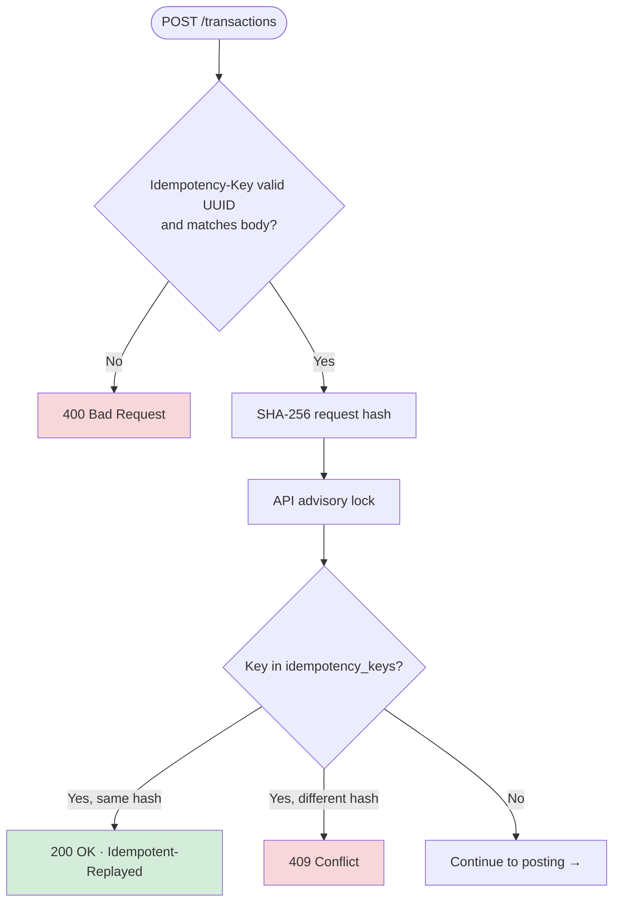
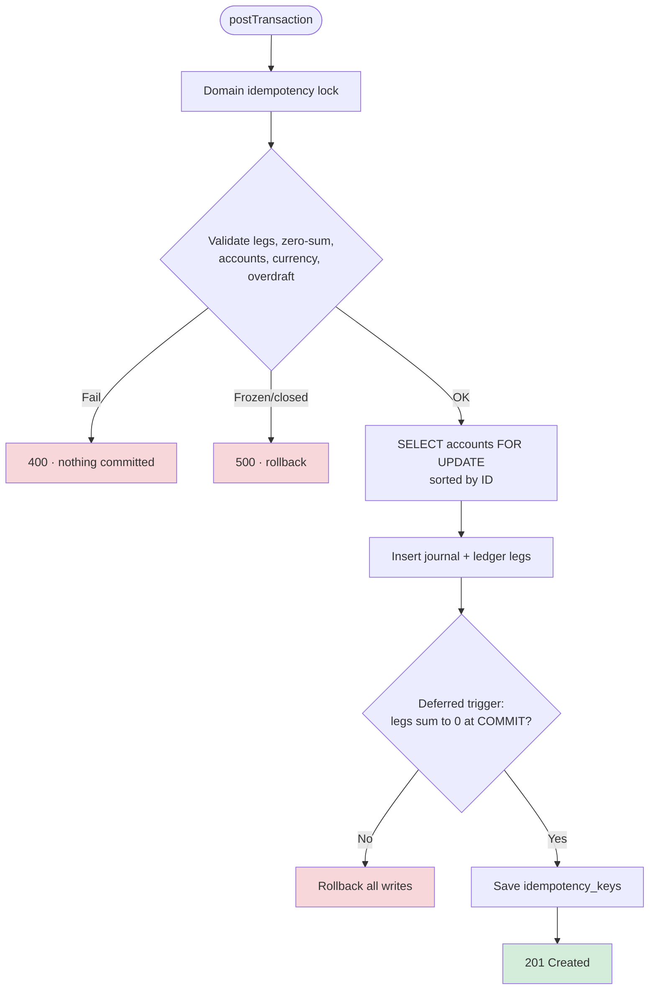
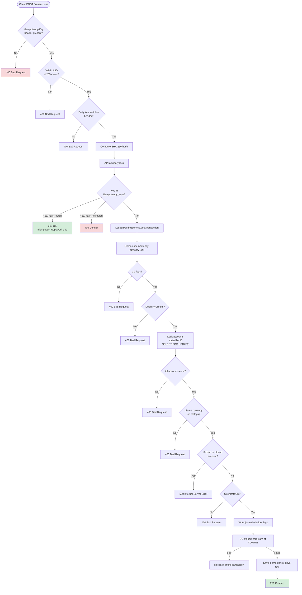

# POST `/transactions` — flow (paste this, not draw.io XML)

Your `%3CmxGraphModel%3E...` blob is **draw.io internal format** (~50KB). Portfolios and GitHub cannot use it.

**Paste one of the Mermaid blocks below** into:

- GitHub README (renders automatically)
- [mermaid.live](https://mermaid.live) → **Export PNG/SVG** for portfolio sites
- draw.io → **+ → Advanced → Mermaid** (paste source, not XML)

---

## Portfolio version (2 small diagrams)

### 1 — Request & idempotency

### 2 — Posting (single DB transaction)

---

## Full detail (one diagram)

Same as your draw.io chart. Source file: `post-transactions-full.mmd`

---

## Immutability note (from your diagram)

Ledger entries are **append-only** — no `UPDATE` or `DELETE` on posted legs; corrections use **reversals**.
